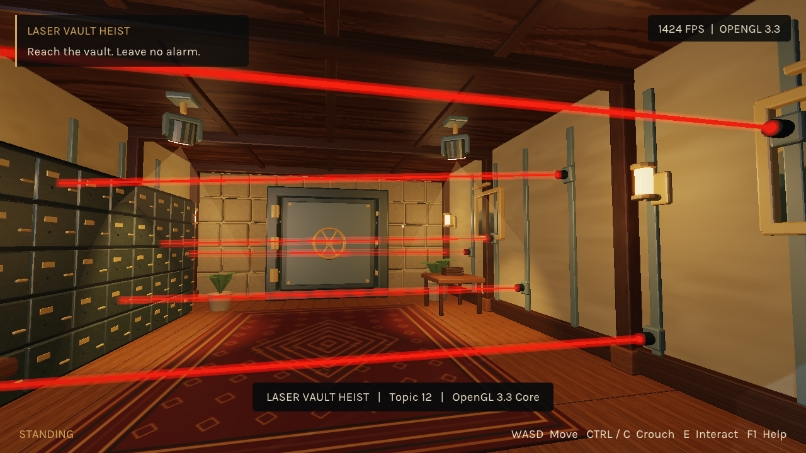

# Laser Vault Heist

A finished single-room stealth game for Computer Graphics Fundamentals, topic 12.
Walk through a mansion vault, time six laser barriers, crouch below the last beam,
and open the hinged safe. Contact with a laser turns the scene red and ends the attempt.

Student: Nurbek Yerbulekov  
Group: SE-2428



## Run the Windows release

Download `LaserVaultHeist-Windows-x64.zip` from [Releases](https://github.com/Bornqazaq/laser-vault-heist/releases).
Extract the entire folder and run `LaserVaultHeist.exe`. Keep `assets/` and `shaders/`
beside it. No Blender, MCP, Codex, network connection or additional runtime installation
is needed. A working OpenGL 3.3 graphics driver is required. Escape pauses the game.

## Build from source

All C/C++ library sources are vendored. There is no FetchContent, package download,
or network access during configure, build or game startup. A C++17 compiler and
CMake 3.20+ are required. The course starter was not supplied; C++17/CMake is the
brief's permitted baseline, not a verified match to an unknown starter.

Windows with Visual Studio 2022 C++ desktop tools:

```powershell
cmake -S . -B build -G "Visual Studio 17 2022" -A x64
cmake --build build --config Release --parallel
ctest --test-dir build -C Release --output-on-failure
.\build\Release\LaserVaultHeist.exe
```

Verified toolchain: LLVM-MinGW 20261020 (Clang 23.1.4), CMake 3.31.6, Ninja 1.11.1.
With their `bin` directories on PATH:

```powershell
cmake -S . -B build -G Ninja -DCMAKE_BUILD_TYPE=Release -DCMAKE_C_COMPILER=clang -DCMAKE_CXX_COMPILER=clang++
cmake --build build --parallel
ctest --test-dir build --output-on-failure
.\build\LaserVaultHeist.exe
```

`tools/build/build.ps1 -Test` is a convenience wrapper for this LLVM/Ninja workflow.
It also detects project-local tools in `.tools`, which are not distributed.
Never reuse a CMake build directory between different compilers.

Linux/macOS: use `cmake -S . -B build -DCMAKE_BUILD_TYPE=Release`, then
`cmake --build build` and `ctest --test-dir build`. Linux requires the native X11/Wayland
development packages expected by GLFW; macOS needs Xcode command-line tools.
The macOS forward-compatible context path is present. These platforms and MSVC
were not run here; only Windows LLVM-MinGW has direct build/run evidence.

## Controls

| Input | Action |
|---|---|
| Enter / Begin | Start |
| WASD | Walk |
| Mouse | Look |
| Hold Left Ctrl or C | Crouch |
| E | Use the object under the reticle within 2.15 m |
| R | Retry after alarm or victory |
| Esc | Pause / resume |
| F1 | Controls help |
| F12 | Save a screenshot in `evidence/screenshots/` |

Three interactions: desk lamp on/off; switch between two live CCTV views; open the safe.
The safe requires a real crossing of the final laser. Try crouching before approaching it.

## Implemented features

- Own OpenGL 3.3 core renderer, GLSL 330 shaders, indexed VAO/VBO/EBO meshes.
- Six moving/rotating laser boxes; inverse-transform point/box collision sampled over
  the player's body; fixed 240 Hz simulation with retained one-shot input.
- Per-fragment Blinn-Phong, six local lights, two rotating spotlights, a moon source,
  inverse-transpose normals, attenuation, soft spotlight edges, one PCF shadow map.
- Original Blender room and thief, UV-painted textures and mipmaps, scene hierarchy,
  static instancing, own 20-bone skinning and five blended animation clips.
- Live CCTV render-to-texture including the complete animated character; hinged safe,
  wheel and bolts; menu, pause, alarm, retry and victory UI; continuous FPS counter.
- HDR framebuffer, small glow, credited filmic fit, gamma conversion and vignette.

## Project layout

| Path | Purpose |
|---|---|
| `src/`, `include/`, `shaders/` | C++ modules and custom GPU programs |
| `assets/` | Runtime scene, mesh, animation, texture and font files |
| `art/blender/` | Editable room and rigged character source scenes |
| `assets/exchange/` | GLB exchange resources; the runtime uses documented native exports |
| `tools/blender/` | Actual modeling, rigging, validation and export scripts |
| `tests/` | Collision, state, complete-route and slow-frame regression tests |
| `docs/` | Architecture, formats, research, rubric evidence and defense guide |
| `deliverables/` | Report, slides, captioned video and subtitle file |
| `evidence/` | Actual screenshots, raw timing CSVs and validation records |
| `LICENSES/`, `CREDITS.md` | Third-party attributions |

## Verification and limits

Three visible 1280x720 runs, each 65 s with a 5 s warm-up, measured 1281.7, 1183.8
and 1215.8 average FPS on an i5-13400F / RTX 5060 / 32 GiB Windows PC. VSync and frame
limiting were disabled. Full frame-loop timing includes simulation, rendering commands,
UI, CSV logging and presentation; these are not isolated GPU timings. Background desktop
work was possible during measurement. See `evidence/benchmarks/summary.json` and raw CSVs.

The 3:30 demo is a real-time 1920x1080 capture of the running application with visible
FPS and captions. Its deterministic controller uses normal game input and collision;
it is a repeatable demonstration, not evidence of human keyboard proficiency.
The final attempt is continuous. No invulnerability, teleports or edited victory frames.

Automated input/state tests and visible rendering were run. Native UI automation could
not obtain app approval in this session, so a human keyboard/mouse usability test is not
claimed. Unknown TA hardware, course-starter compatibility and a live oral defense remain
external checks. No numerical grade is promised.

This is the brief's single-author teaching example. The older course PDF described teams
of 3-5; no additional team members, classroom milestones or presentations are invented.
The brief supersedes the old AI-note requirement. Attribution obligations remain in force.

## Reproduce assets and evidence

See `docs/asset-pipeline.md`, `docs/runtime-formats.md`, `docs/demo-script.md`,
`docs/defense-guide.md` and `docs/requirements-evidence.md`.
`--character-preview`, `--face-preview`, `--rest-pose`, and `--clip Walk` are art QA tools.
`--demo` runs the 210-second presentation route. `--auto-route --seconds 65` repeats
legal play for performance sampling. `--1080p` selects 1920x1080.
`--root PATH` overrides the asset directory for development; ordinary releases discover
assets beside the executable, regardless of the working directory.

Use `python tools/capture/capture_demo.py --ffmpeg PATH` to re-record on Windows.
FFmpeg is an optional recording tool and is not required or shipped with the game.

## Mandatory requirement map

| Requirement | Local result | Evidence |
|---|---|---|
| R1 | OpenGL 3.3 core / own GLSL / indexed buffers | src/main.cpp, src/graphics.cpp, shaders, runtime diagnostics |
| R2 | 5+ distinct original objects | assets/vault.scene, art/blender/vault.blend |
| R3 | MVP and parent–child hierarchy | scene.cpp, world.cpp; hinged safe and rotating mounts |
| R4 | Per-fragment dynamic lighting | surface.frag; lamp, two spots, alarm recoloring |
| R5 | UVs and mipmaps | graphics.cpp, Blender exports, textures |
| R6 | Keyboard/mouse paths and 3 interactions | main.cpp/game.cpp; automated gameplay coverage; manual usability untested |
| R7 | Local 30/60 FPS targets exceeded | Three raw benchmarks; TA hardware remains untested |
| R8 | Clean C++17/CMake Release build passes | Vendored dependencies, CTest; exact course starter unavailable |

Full criteria, actual checks and video timings: [requirements-evidence.md](docs/requirements-evidence.md).

## Document authoring inputs

The game and its assets build without authoring tools. Rebuilding the report uses the locally supplied `brief/source-materials/Report template.docx`, its recorded template contract, python-docx/reportlab, LibreOffice and Poppler. The supplied course documents/concepts are kept local rather than republished. The editable report intermediate remains local; the delivered report is PDF. The slide authoring script uses the Codex Artifact Tool runtime and validation utilities; the delivered PPTX is editable without them. Exact sources, final PDFs/PPTX, screenshots, hashes and validation records are included.
